<h1 align="center">FreelanceOS</h1>

<p align="center">
  <strong>Find local businesses that need your services, pitch them with AI using what's actually on their website, and track the deals, all from one dashboard.</strong>
</p>

<p align="center">
  <a href="https://freelanceos-red.vercel.app"></a>
  <a href="LICENSE"></a>
  
  
  
</p>

---

## Live demo

**<https://freelanceos-red.vercel.app>**: sign up with email or Google. The dashboard is behind login.

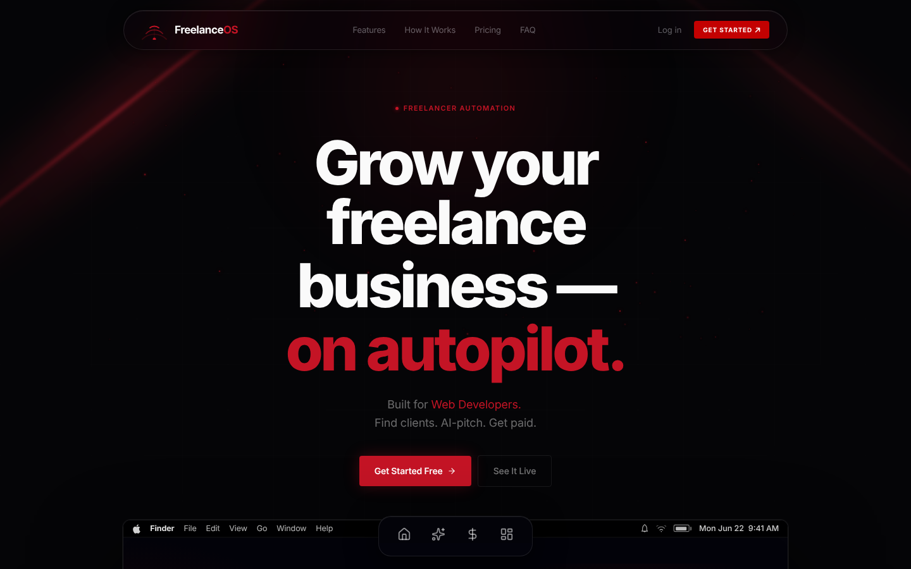

---

## The problem

Freelancers who sell to local businesses (web developers, designers, video editors, social-media managers) usually find work like this:

1. Search Google Maps by hand for "dentists in Pune".
2. Open each business's website and socials to see what's missing.
3. Write a cold email from scratch, or send a generic template that gets ignored.
4. Track who was contacted, and who replied, in a spreadsheet.

The process is slow, and the generic pitch is the expensive part: a message that doesn't say anything specific about the business reads as spam. FreelanceOS automates the search and the research. The pitch is then built from facts checked on the lead's live website, such as "your homepage still says *Coming Soon*" or "your footer says © 2021", not from guesses.

---

## Features

Each feature below is described as the flow a user goes through.

### 1. Discover leads: `/discover`
Enter a business type and a city, then click **Scan**.
- Businesses are fetched from **Apify → SerpAPI → Google Places**, in that order. The first provider that returns results wins.
- Each result is enriched with its website, contact email, phone and social links. The data comes from the business's own site (home, `/contact`, `/about`) and a fallback chain of SERP and scraping providers.
- **Gap badges** are computed: `no-website` (no site, or the site is down), `no-social` (no Instagram or Facebook) and `no-video` (no YouTube). An **opportunity score** is derived from them.
- Enriched businesses are stored in a shared `DiscoverCache` collection with a **30-day TTL**, so repeat searches don't pay for the same paid API calls again.
- The number of results per search depends on the plan: free 15, pro 30, agency 40. The plan is read from the database, never from the request body.

### 2. Research and pitch a lead: `/discover` drawer and `/pitches`
Open a lead and generate a pitch.
- **Ground-truth website audit.** The server fetches the lead's live site through the `safeFetch` SSRF guard. It then flags concrete problems: the site is unreachable, placeholder "coming soon" copy, a stale copyright year, plain HTTP, a missing meta description, or a slow response.
- **Pitch memory (RAG without a vector DB).** Your past pitches are scored by industry match, shared gaps and outcome (won > replied > approved > sent). The top matches are injected as few-shot examples.
- **Multi-stage generation** on Groq (`/api/pitch`): **research brief → draft → critique → final**. That is four chained LLM calls after the audit. Regenerating overwrites the lead's existing draft and never overwrites a pitch that has already been sent.
- **Chat mode** (`/api/pitch/chat`): the freelancer picks the service they're selling, the agent reports the flaws it found, then writes the pitch around them.

### 3. Run a campaign: `/outreach`
Select saved leads, tick channels (Email, WhatsApp, LinkedIn, Instagram) and click **Launch**.
- The server streams progress back over **Server-Sent Events**: `start → generating → pitch_generated → email_sent / channel_ready → done … → complete`. The page renders each event live.
- Leads are processed in parallel waves, one lead per configured Groq API key. If a call fails, it is retried on the next key, and on fallback models if the primary model is retired.
- **Email really sends**, through the user's connected Gmail (OAuth) or their own SMTP server. Addresses that were only *guessed* (`info@domain`) are never auto-sent.
- **WhatsApp, LinkedIn and Instagram are hand-off only.** The app writes the message and opens a `wa.me` link or the profile URL for you to paste and send. Automating DMs on those platforms breaks their terms of service.
- Every pitched lead gets a `Deal` row, and a `Notification` summarises the run.

### 4. Track the pipeline: `/deals`, `/clients`, `/dashboard`
- A Kanban pipeline with the stages `pitched → responded → meeting → proposal → won / lost`, plus CSV export.
- A saved-clients table with contactability stats and CSV export.
- The dashboard shows counters (clients, pitches sent, active deals, revenue won), a recent-activity feed and an onboarding checklist.

### 5. Work as a team: `/team`, `/settings`
- Every user belongs to a **workspace** (`Organization`). A solo workspace is created automatically on first use.
- Teammates join with an 8-character invite code drawn from a crypto-random, look-alike-free alphabet. The number of seats is capped by plan: 3, 10 or 100.
- `/team` shows activity per member: saved, generated, sent, replies, active deals, won and revenue.
- In `/settings` you connect Gmail or your own SMTP server. SMTP credentials are tested against the live server before they are saved.

---

## Screenshots

> Captured with Playwright (headless Chromium) from a **local production build** (`npm run build && npm run start`) running against a local MongoDB. The live site could not be reached from the environment these screenshots were taken in. The three "Sample …" clients and two deals were entered through the app's own `POST /api/clients` and `POST /api/deals` endpoints. No API keys for discovery or Groq were configured, so the screenshots show no search results or generated pitches.

| Dashboard | Discover |
|---|---|
| 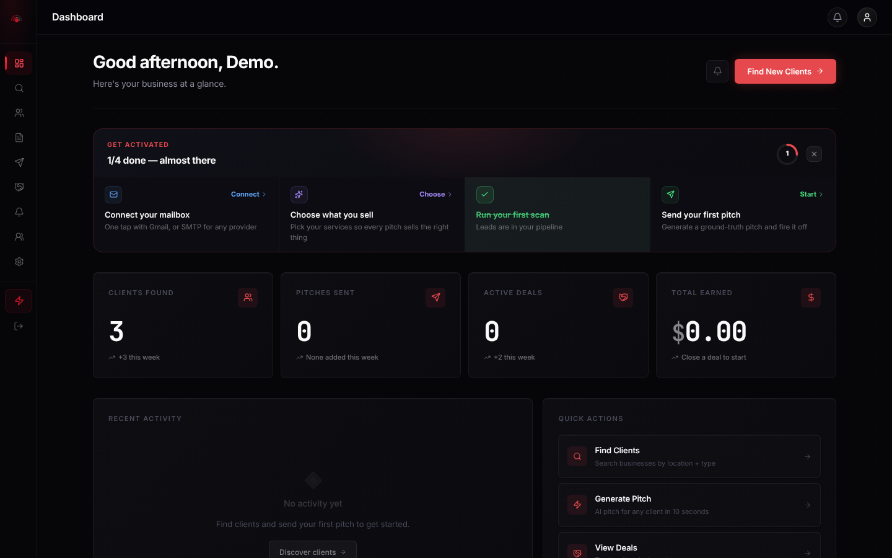 | 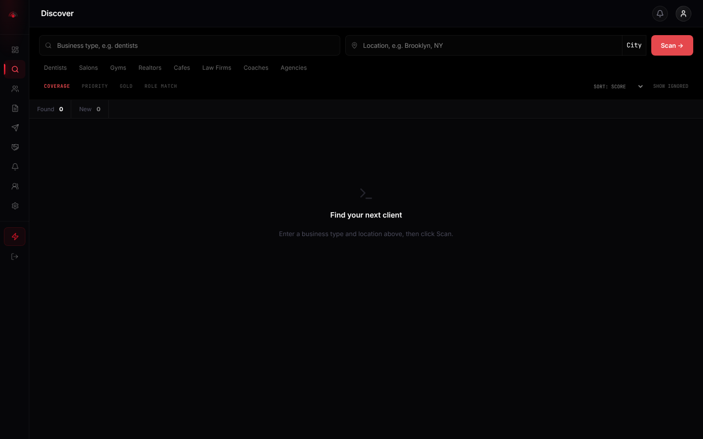 |
| **Outreach** | **Deal pipeline** |
| 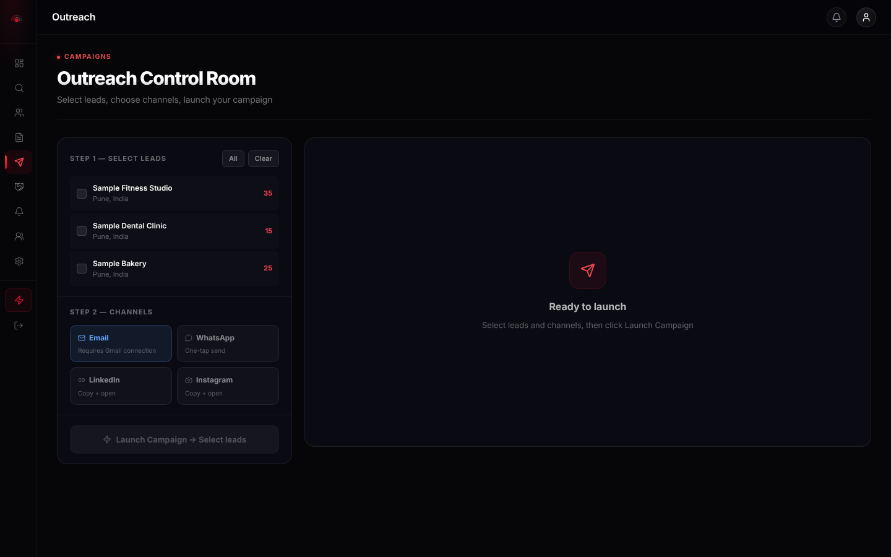 | 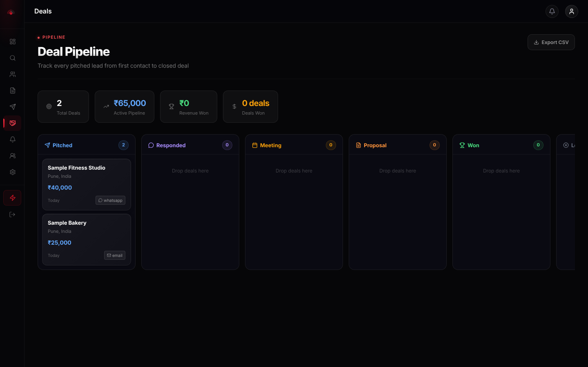 |
| **Saved clients** | **Team** |
| 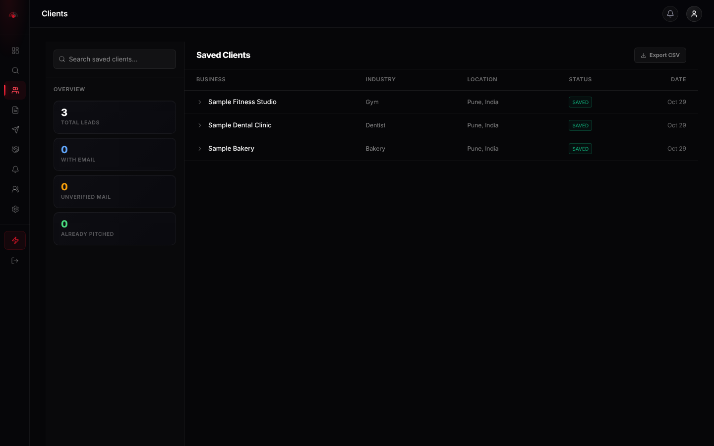 | 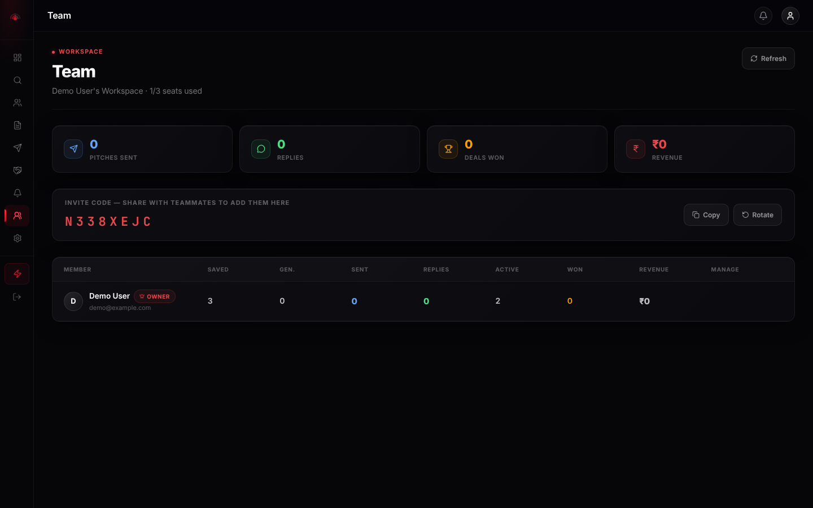 |
| **Settings: workspace and email transports** | **Mobile, 390 px wide** |
| 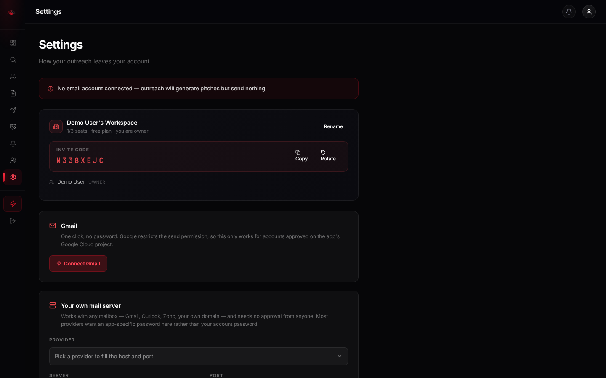 | 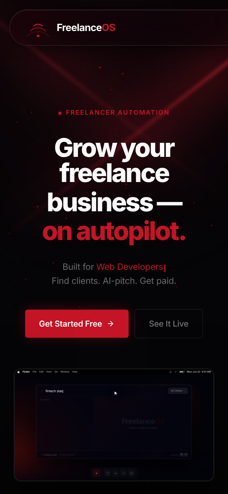 |

---

## Architecture

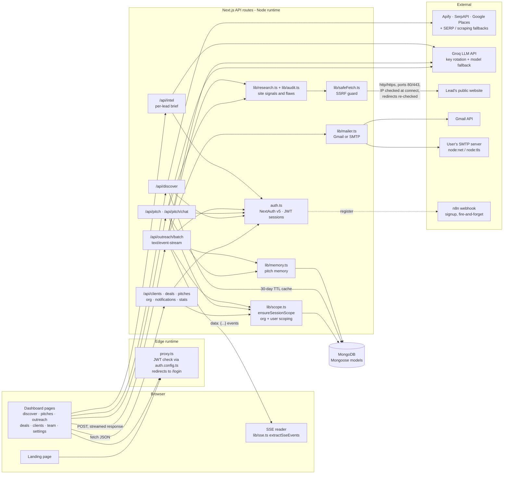

**`safeFetch`, the SSRF guard.** Users and scrapers decide which URLs the server fetches, so a lead's "website" could be `http://169.254.169.254/` or a hostname that resolves to `10.0.0.5`. `safeFetch` closes that hole:
- It allows only `http`/`https` on ports 80 and 443.
- It resolves DNS **inside the socket's connect step**, using a custom undici `lookup`. The IP that gets checked is therefore the IP that gets connected to, which leaves no DNS-rebinding window between the two.
- It rejects private and reserved IPv4 ranges. For IPv6 it allows only global unicast (`2000::/3`) minus 6to4 and Teredo, and it unwraps IPv4-mapped IPv6 in any notation.
- It follows redirects manually, at most 5, and runs every hop through the same checks.

**SSE feed.** `/api/outreach/batch` returns a `ReadableStream` with `Content-Type: text/event-stream` and writes one `data: {json}` frame per event. The client reads the stream with `fetch` instead of `EventSource`, because the request is a `POST` with a JSON body. TCP chunks can split a frame in half, so `extractSseEvents` carries the incomplete trailing line over into the next read.

---

## Request flow: launching a campaign

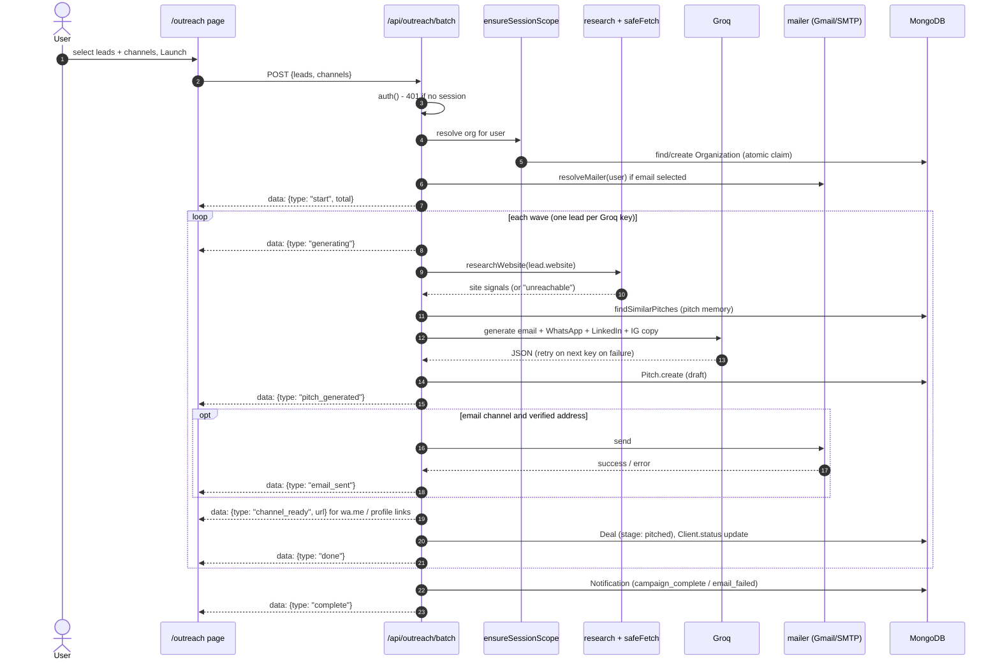

---

## Data model

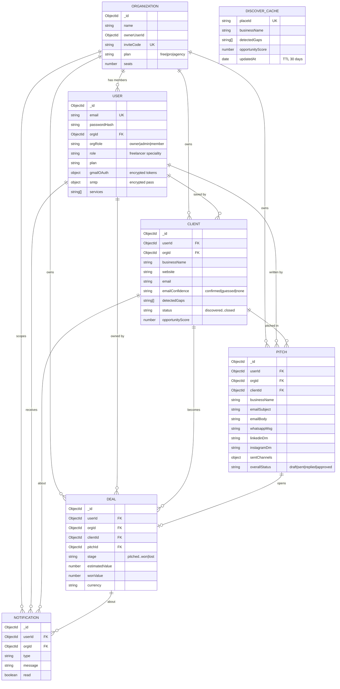

All models live in [`src/lib/models/`](src/lib/models).

| Entity | Purpose | Notable fields / indexes |
|---|---|---|
| **Organization** | A workspace that owns all team data | `inviteCode` unique; `seats` capped by `plan` |
| **User** | An account, plus the freelancer's profile | `email` unique; `orgId` + `orgRole`; `gmailOAuth` and `smtp` sub-documents with secrets encrypted using AES-256-GCM; index `{orgId}` |
| **Client** | A saved lead | `detectedGaps`, `opportunityScore`, `emailConfidence`, `status`; indexes `{userId, createdAt}` and `{orgId, createdAt}` |
| **Pitch** | Generated copy for each channel and per-channel send state | `overallStatus` enum shared with the API through `PITCH_STATUSES`; three compound indexes for the list and filter queries |
| **Deal** | A pipeline card | `stage` enum, per-stage timestamps, `notes[]`; indexes `{userId, stage}`, `{orgId, stage}`, `{userId, createdAt}` |
| **Notification** | The activity feed | 10 `type` values; indexes `{userId, createdAt}` and `{userId, read}` for the feed and the unread badge |
| **DiscoverCache** | A shared cache of enriched businesses, keyed by `placeId` | No per-user state on purpose; a TTL index on `updatedAt` expires entries after 2,592,000 s (30 days) |

---

## Tech stack

| Part | Tool | Why |
|---|---|---|
| **Frontend** | Next.js 16 (App Router), React 19, Tailwind CSS 4 | One codebase for the marketing page, the dashboard and the API; React Server Components and static pre-rendering for public pages |
| | Framer Motion, Lenis, Radix primitives, lucide-react, Sonner | Entrance animations and smooth scrolling on the landing page; accessible accordion, dialog and tab primitives; icons; toasts |
| **Backend / API** | Next.js Route Handlers (Node runtime) | Co-located with the UI and deployed as serverless functions on Vercel; a `ReadableStream` provides the SSE campaign feed |
| | Groq SDK (`openai/gpt-oss-120b` by default, overridable with `GROQ_MODEL`) | Fast, cheap inference. Rotates across up to 4 keys plus a fallback key, and walks a fallback model list when Groq retires a model |
| | cheerio, undici | HTML parsing for the site audit; undici's `Agent` provides the connect-time DNS hook that `safeFetch` relies on |
| **Database** | MongoDB with Mongoose 9 | Flexible documents for scraped lead data. A cached connection is reused across serverless invocations, and `strictQuery: 'throw'` catches filters on fields that don't exist |
| **Auth / security** | NextAuth v5 (Google, GitHub, email + bcrypt password) with JWT sessions | No DB adapter, so the app has a single Mongoose pool. An Edge-safe `auth.config.ts` is used by `proxy.ts` |
| | Node `crypto` AES-256-GCM, `safeFetch`, field whitelists (`lib/sanitize.ts`), security headers in `next.config.ts` | Encrypts mailbox credentials at rest, blocks SSRF and mass assignment, and sets HSTS, `X-Frame-Options`, `nosniff` and a CSP (Report-Only) |
| **Email** | Gmail API (OAuth) **or** a hand-written SMTP client on `node:net`/`node:tls` | Gmail's send scope is restricted by Google, so bring-your-own SMTP works for every user without Google's approval |
| **Testing** | Vitest 4 | Fast TypeScript-native unit tests for the pure logic |
| **CI / deploy** | Vercel | Hosts the live demo with serverless API routes. There is **no GitHub Actions CI** in this repo yet; tests, typecheck and lint are run locally |

---

## Project structure

```
src/
├── proxy.ts              # Edge route protection (Next 16 name for middleware)
├── auth.ts               # NextAuth config: providers, user upsert, JWT callbacks (Node only)
├── auth.config.ts        # Edge-safe auth subset used by proxy.ts
├── app/
│   ├── (auth)/           # /login, /signup
│   ├── (dashboard)/      # dashboard, discover, clients, pitches, outreach, deals, notifications, team, settings
│   ├── api/              # 31 route handlers: discover, pitch, outreach, clients, deals, org, gmail, settings, stats…
│   └── page.tsx          # Landing page
├── components/           # layout, landing sections, discover, pitches, settings, dashboard, ui kit
├── hooks/                # useDiscoverKeyboard (keyboard navigation on /discover)
└── lib/
    ├── models/           # Mongoose schemas (7 models)
    ├── safeFetch.ts      # SSRF-safe fetch
    ├── research.ts       # Site signal extraction
    ├── audit.ts          # Flaw detection from site signals
    ├── memory.ts         # Pitch memory retrieval and scoring
    ├── scope.ts          # Workspace scoping and seat limits
    ├── sse.ts            # SSE frame parser
    ├── mailer.ts         # Gmail / SMTP transport selection
    ├── gmail.ts · smtp.ts · encryption.ts · sanitize.ts · groq.ts · …
tests/                    # Vitest unit tests (10 files)
docs/                     # Design notes and README screenshots
```

---

## Getting started

### Prerequisites
- **Node.js ≥ 20.9** (the minimum Next 16 requires; verified on Node 22)
- **MongoDB**: Atlas, or local (`docker run -d -p 27017:27017 mongo:7` works)
- A **Groq API key** for pitch generation
- A **Google OAuth client** for Google sign-in and Gmail sending (optional for local use, because email + password sign-in works without it)
- At least one discovery key (`APIFY_API_TOKEN` or `GOOGLE_PLACES_API_KEY`) for `/discover` to return results

### Environment variables
Copy the template and fill it in: `cp .env.example .env.local`. Only the variable names are listed here; see [`.env.example`](.env.example) for a comment on each one.

| Group | Variables |
|---|---|
| Required | `MONGODB_URI`, `NEXTAUTH_URL`, `NEXTAUTH_SECRET`, `GOOGLE_CLIENT_ID`, `GOOGLE_CLIENT_SECRET`, `GROQ_API_KEY_1` … `GROQ_API_KEY_4`, `GROQ_API_KEY_FALLBACK`, `TOKEN_ENCRYPTION_KEY` |
| Optional model override | `GROQ_MODEL` |
| Gmail sending | `GMAIL_REDIRECT_URI`, `NEXT_PUBLIC_APP_URL` |
| GitHub sign-in | `GITHUB_ID`, `GITHUB_SECRET` |
| Discovery | `APIFY_API_TOKEN`, `GOOGLE_PLACES_API_KEY`, `SERPER_API_KEY`, `SERPAPI_KEY`, `GOOGLE_CSE_KEY`, `GOOGLE_CSE_ID`, `SCALESERP_KEY`, `VALUESERP_KEY`, `SERPSTACK_KEY`, `SCRAPINGBEE_KEY`, `SCRAPINGANT_KEY`, `ZENROWS_KEY` |
| n8n | `N8N_SIGNUP_WEBHOOK_URL` |

`TOKEN_ENCRYPTION_KEY` must be 64 hex characters (`openssl rand -hex 32`). `NEXTAUTH_SECRET` can come from `openssl rand -base64 32`. Of the Groq keys, only one is strictly needed.

### Run

```bash
git clone https://github.com/Zakuroooo/FreelanceOS.git
cd FreelanceOS
npm ci
cp .env.example .env.local      # fill in
npm run dev                     # http://localhost:3000
```

| Command | What it does |
|---|---|
| `npm run dev` | Turbopack dev server |
| `npm run build` / `npm run start` | Production build and serve |
| `npm test` | Vitest unit tests |
| `npm run typecheck` | `tsc --noEmit` |
| `npm run lint` | ESLint |

All of these were run for this README on Node 22 with a local MongoDB. `build`, `typecheck` and `test` pass. `lint` reports 0 errors and 48 warnings. The dev server serves `/`, redirects `/dashboard` to `/login` when signed out, and returns `401` from `/api/stats` without a session.

#### Google OAuth redirect URIs
Register both of these on the same OAuth client. In production, use your own domain instead of `localhost:3000`:
- `http://localhost:3000/api/auth/callback/google` (sign-in)
- `http://localhost:3000/api/gmail/callback` (Gmail send; also enable the Gmail API and add the `gmail.send` scope)

---

## Testing

```bash
npm test
```

```
 Test Files  10 passed (10)
      Tests  49 passed (49)
```

The tests cover the pure logic, where the bugs were. Many of them are named after the regression they pin down.

| File | Tests | Covers |
|---|---:|---|
| `audit.test.ts` | 7 | Flaw detection: unreachable site, "coming soon" copy, stale vs current copyright year, HTTP, missing meta, slow load, severity order |
| `format.test.ts` | 7 | `daysSince` / `timeAgo` / `formatCurrency`, including future dates clamped to "Today" |
| `memory.test.ts` | 6 | Pitch-memory ranking (won + same industry first, gap overlap capped) and prompt formatting |
| `socials.test.ts` | 6 | Instagram/LinkedIn URL normalisation from full URLs, handles and junk |
| `research.test.ts` | 5 | HTML signal extraction, HTTP detection, never throwing on bad input |
| `leads.test.ts` | 4 | Contactability score with no double-counting of a shared WhatsApp/phone number |
| `sanitize.test.ts` | 4 | Field whitelists; dropping `$`-operator and dotted keys (NoSQL injection) |
| `scope.test.ts` | 4 | Seat limits per plan, invite-code alphabet and uniqueness, attribution scoring |
| `sse.test.ts` | 4 | SSE frame parsing, including a frame split across two chunks |
| `discoverCache.test.ts` | 2 | Cache schema paths and the 30-day TTL index |

**Not covered:** API routes, database integration, the React UI, and `safeFetch` itself. No test exercises its IP-blocking rules yet; see the roadmap.

---

## Key engineering decisions

Each item below names a problem that came up during the build and the fix that went in.

- **SSRF via lead websites → `safeFetch` with a connect-time IP check.** The first version validated the URL and then fetched it, which left a DNS-rebinding gap: a hostname could resolve to a public IP during the check and to a private IP at connect time. The current version does the lookup inside undici's socket `connect`, rejects any blocked address in the result set, and re-validates every redirect hop.
- **Duplicate workspaces under concurrent requests → atomic claim.** A cold dashboard fires several API calls at once, and each one used to see "no org" and create its own workspace, which scattered the user's data. `ensureSessionScope` now creates a candidate org and claims it with a conditional `findOneAndUpdate({ orgId: { $exists: false } })`. Callers that lose the race delete their duplicate and adopt the winner's org. The same call lazily backfills `orgId` onto the user's existing records, so no migration script was needed.
- **SSE frames lost at chunk boundaries → buffered parser.** Splitting each network chunk on `\n` silently dropped events whose `data:` line spanned two chunks. `extractSseEvents` now returns the unfinished tail, which is prepended to the next chunk. A unit test pins this down.
- **Gmail's restricted scope → bring-your-own SMTP.** `gmail.send` only works for allow-listed test users until the app passes Google verification plus a paid annual security assessment. So `lib/smtp.ts` implements SMTP submission directly with STARTTLS/implicit TLS, `AUTH LOGIN/PLAIN`, dot-stuffing and base64 bodies, and it refuses to send credentials without TLS. Credentials are verified against the live server before they are saved.
- **OAuth sign-in broken by the DB adapter → no adapter.** `@auth/mongodb-adapter` opened a second connection pool and wrote `users` documents without matching `accounts` documents, which caused `OAuthAccountNotLinked`. Sessions are JWT, so the adapter was removed and the `jwt` callback upserts the Mongoose `User` itself. Google sign-ins whose email is not verified are rejected.
- **Mass assignment → whitelists.** Routes used to spread `...body` into `Model.create()`, so a request could set `userId` to someone else's ID. `pick()` copies only named fields and drops keys that start with `$` or contain `.`. Every query is scoped by `userId` or `orgId`.
- **Silent wrong counts → `strictQuery: 'throw'`.** A filter on a non-existent field (`status` instead of `overallStatus`) used to be dropped silently, so the query matched every document. Mongoose now throws instead.
- **Model retirement → fallback chain.** Groq has retired hosted models this project depended on (for example `llama-3.3-70b-versatile`). The model name lives in one place, and calls walk a fallback list when the error is "model unavailable".
- **Paid API cost → shared cache with no per-user state.** Enrichment costs paid Apify/SERP calls, so results are cached by `placeId` for 30 days and shared across users. Per-user lead state is kept out of that shared document so one user can't overwrite what others see.

---

## Limitations and roadmap

These are stated plainly so the README matches the code.

**Known limitations**
- **No CI pipeline.** There is no `.github/workflows`. Tests, typecheck and lint only run when someone runs them locally.
- **`safeFetch` has no unit tests.** Its blocking rules for IPv4 ranges, IPv6 and mapped addresses are untested.
- **Discovery enrichment does not use `safeFetch`.** `/api/discover` scrapes business websites, whose URLs come from the Apify/SERP/Places results, with plain `fetch`. Only the research and audit path used by pitch generation goes through the SSRF guard.
- **No rate limiting or usage quotas in the API.** `monthlyPitchCount` exists on `User` but nothing enforces it, and `/api/outreach/batch` has no cap on the number of leads per request.
- **Stripe is not implemented.** The `stripe` packages are installed and `User` has `stripeAccountId`, but there is no payment, escrow or billing code. Plans (`free/pro/agency`) can only be changed in the database.
- **LinkedIn, Instagram and WhatsApp are not automated.** The app writes the message and opens a link; a person sends it.
- **The CSP is Report-Only.** It logs violations but doesn't block them yet, and it still needs `'unsafe-inline'` for scripts and styles.
- **There are mobile layout issues at 390 px,** seen while taking these screenshots. On dashboard pages the icon sidebar is drawn over the page content alongside the bottom tab bar. On the landing page the navbar pill is clipped at the right edge.
- **Some settings aren't built yet:** profile, pricing and plan tabs. Only the workspace and email-transport settings exist.

**Roadmap**
- [ ] GitHub Actions: typecheck, lint, test and build on every PR
- [ ] Unit tests for `isBlockedIP` / `assertPublicUrl`; route `/api/discover` scraping through `safeFetch`
- [ ] Per-user rate limits and an enforced monthly pitch quota
- [ ] Fix the dashboard sidebar on mobile
- [ ] Stripe billing for plans
- [ ] Switch the CSP from Report-Only to enforcing
- [ ] Integration tests for API routes against an in-memory MongoDB

---

## License

[MIT](LICENSE)
